# retro-wall

A live desktop wallpaper: a scene that moves (a synthwave horizon, a rainy neon city, an arctic night,
the digital rain, a winter field, a pirate island), with the machine's readings in it: meters, a tape
deck that plays with the disks, the network's traffic as mountains, its status line.

One Rust binary. It draws on the GPU (OpenGL 3.3, or 2.1 on older hardware), presents a frame only when
something in it changed, and stops while the picture is covered or the machine is on battery.

[](https://github.com/PacAnimal/retro-wall/actions/workflows/test.yml)


[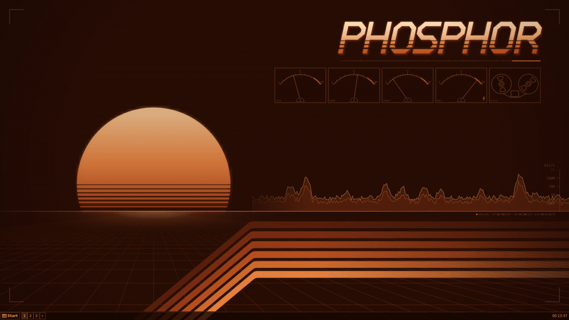](screenshots/landscape.png)

<sub>Scaled down. Click for a full-resolution still.</sub>

## Themes

Pick one with `--theme NAME`. Click a picture for the full size.

| | |
|---|---|
| [](screenshots/landscape.png) **phosphor** (default): a synthwave horizon in CRT amber | [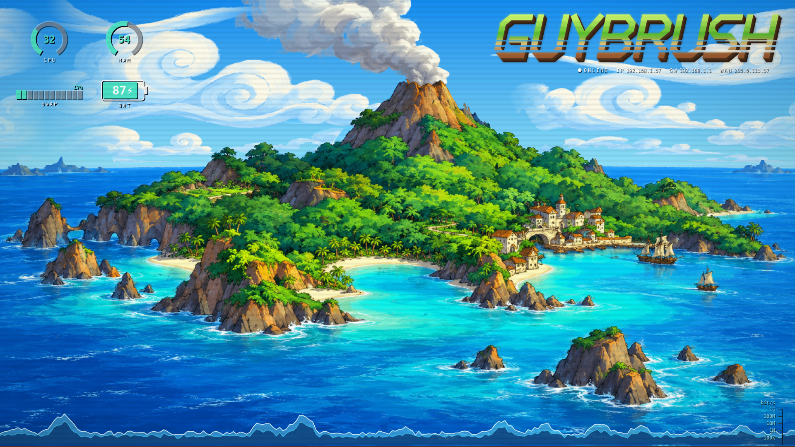](screenshots/themes/guybrush.png) **guybrush**: a painted pirate island |
| [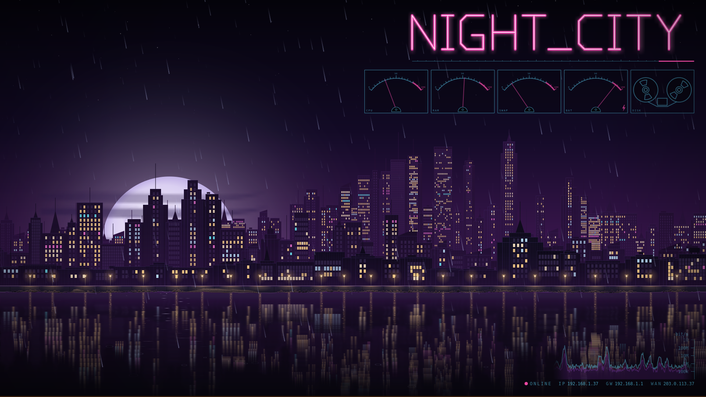](screenshots/themes/night_city.png) **night_city**: a cyberpunk city in the rain | [](screenshots/themes/neon_rain.png) **neon_rain**: a room over a rainy neon city |
| [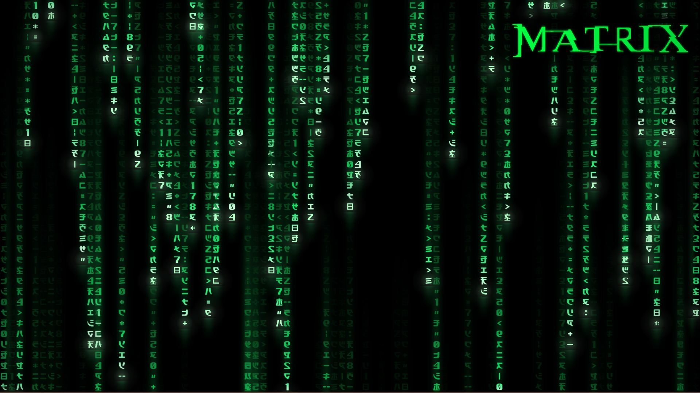](screenshots/themes/matrix.png) **matrix**: the digital rain | [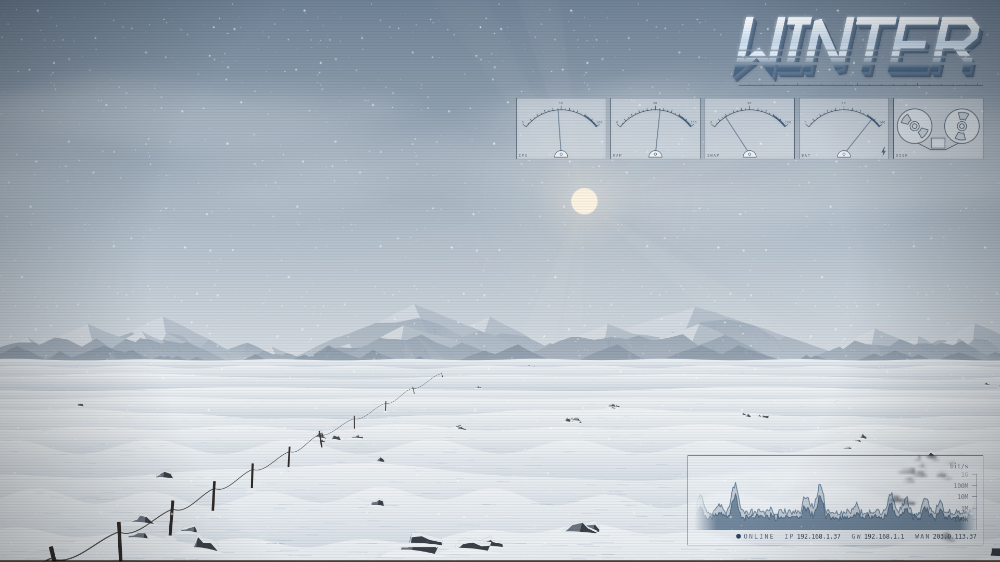](screenshots/themes/winter-day.png) **winter**: a snowfield that follows the clock |
| [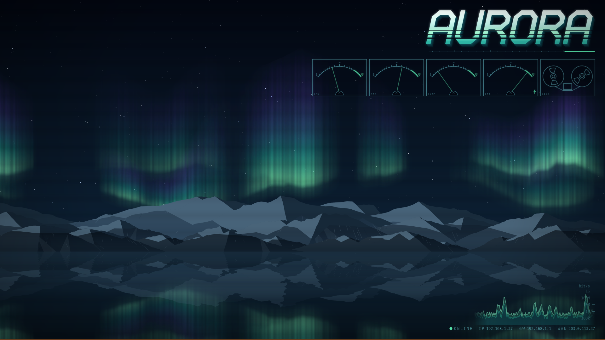](screenshots/themes/aurora.png) **aurora**: northern lights over open water | **[Your theme here](EXTENDING.md)** |

Every theme moves:

- **phosphor**: the floor scrolls toward you and the sun shimmers (above).
- **neon_rain**: rain falls on the city and runs down the window. The signs dim, the lamp flickers, and
  the TV changes channel through interference.

  [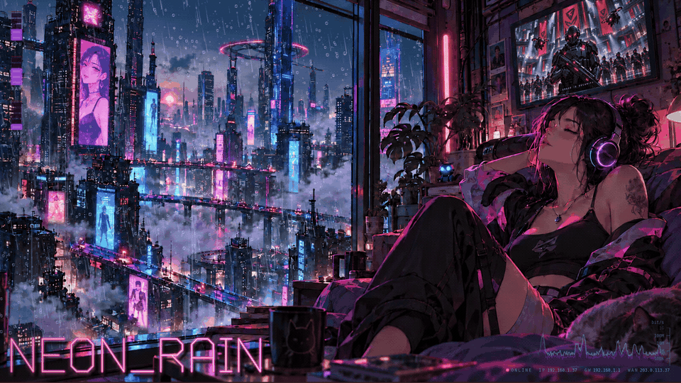](screenshots/themes/neon_rain.png)

- **night_city**: windows light and go dark. The neon flickers.

  [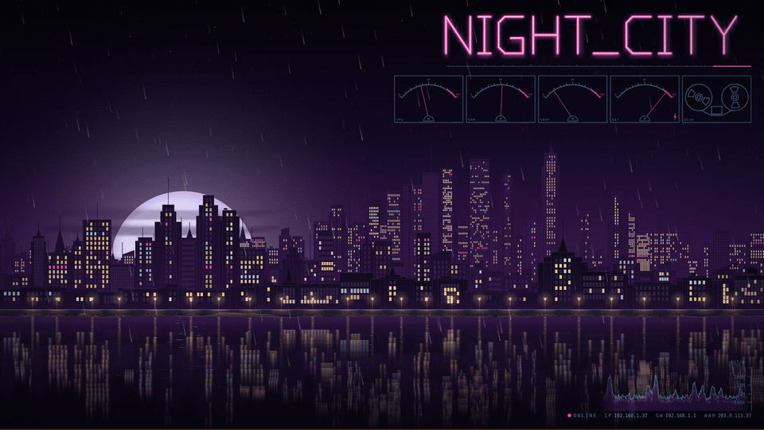](screenshots/themes/night_city.png)

- **matrix**: the rain falls. By default it shows only the rain. Set `[monitors]` in `retro.toml` to
  show the hostname, instruments and graph (shown here).

  [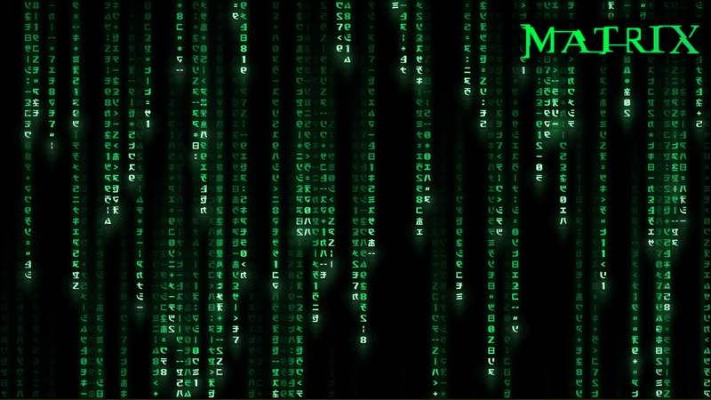](screenshots/themes/matrix.png)

- **winter**: day turns to night with the local clock. The snow blows in gusts.

  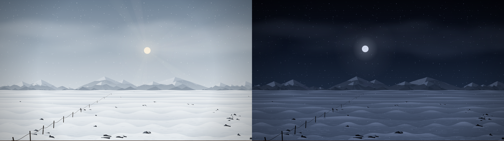

  [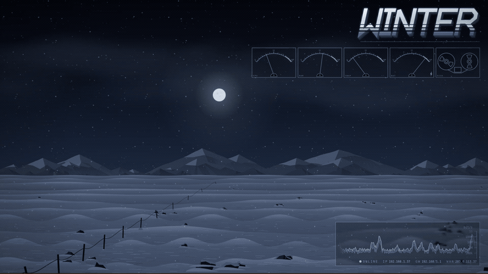](screenshots/themes/winter-night.png)

- **aurora**: the curtains of light drift and fold, and the water mirrors them.

It stays below every window and desktop icon, and clicks go to the desktop:

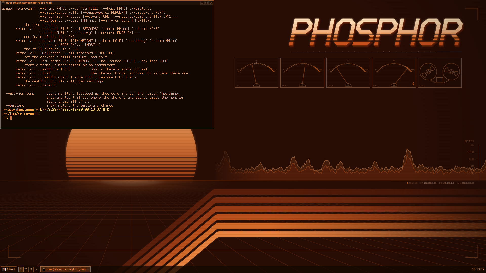

Every size is a fraction of the screen, so each theme fits any resolution, portrait included. A painted
theme is cropped around a point the theme sets:

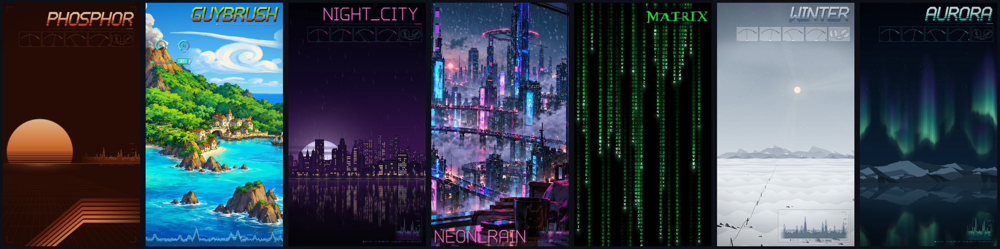

## Install

Each release has an archive for Linux (x86_64), macOS (Apple silicon) and Windows (x86_64): the
program, the themes and that system's installer. Unpack it and run the installer as yourself, not as
an administrator. Running it again updates; the uninstaller puts the desktop's own wallpaper back.

**Linux** (X11: XFCE, KDE Plasma, GNOME, Cinnamon, MATE, LXDE, or a window manager alone; glibc 2.35 or
newer: Debian 12, Ubuntu 22.04 and later):

```sh
tar xzf retro-wall-VERSION-linux-x86_64.tar.gz && cd retro-wall-VERSION-linux-x86_64
linux/install                 # libraries if missing, ~/.local/share/retro, starts at login and now
linux/uninstall               # back as it was
```

**macOS** (11 or later):

```sh
tar xzf retro-wall-VERSION-macos-arm64.tar.gz && cd retro-wall-VERSION-macos-arm64
xattr -dr com.apple.quarantine .   # a downloaded program is held back until this, or until allowed
macos/install                 # ~/Library/Application Support/retro-wall, a LaunchAgent, starts now
macos/uninstall
```

**Windows** (10 or 11): unpack `retro-wall-VERSION-windows-x86_64.zip`, then in that directory:

```powershell
powershell -ExecutionPolicy Bypass -File windows\install.ps1     # %LOCALAPPDATA%\retro-wall, at logon and now
powershell -ExecutionPolicy Bypass -File windows\uninstall.ps1
```

### From source

With Rust (`rustup`, edition 2024) and cairo's development files:

```sh
# Linux: apt install libcairo2-dev, dnf install cairo-devel, or pacman -S cairo
cargo build --release
linux/install
```

The release build is stripped; `cargo build --profile profiling` keeps symbols and line tables for a
profiler. macOS and Windows builds link cairo statically, so the binary needs nothing installed. The
release recipes, the Linux one in an older system for its glibc, are in `ci/README.md`. Then
`macos/install`, or `windows\install.ps1` with `retro-wall.exe` from
`target\x86_64-pc-windows-gnu\release` put beside `windows\`.

The typeface, DejaVu Sans Mono, is carried in the program: nothing to install.

### macOS installer

`macos/install [OPTION]...` works from a release archive or a checkout (it builds with cargo). The
OPTIONs are retro-wall's own and go in the LaunchAgent; run `macos/install` again to change them. On a
Mac whose desktop picture is set by a configuration profile, retro-wall shows its still picture itself.

### Windows installer

`windows\install.ps1 [OPTION]...` takes retro-wall's options, for example `--theme neon_rain`. It
installs into `%LOCALAPPDATA%\retro-wall` and registers the scheduled task `\retro-wall\retro-wall`,
which starts it at logon and brings it back within 5 minutes if it stops. Run it again to update or to
change the options. The log is `%LOCALAPPDATA%\retro-wall\retro-wall.log` (a run from a
console writes to the console). `retro.toml`, plugins and your own themes go in `%APPDATA%\retro`.

## Use

```sh
retro-wall                                   # the live wallpaper (the installer starts it)
retro-wall --theme neon_rain                 # another theme
retro-wall --all-monitors                    # every monitor, followed as they come and go
retro-wall --snapshot out.png                # one frame, fixed readings
retro-wall --preview out.png 2560x1440       # the still picture
retro-wall --list                            # themes, element kinds, sources, widget types
retro-wall --help                            # every option
```

Options for the autostarted instance go in `~/.config/retro/retro-wall.conf`, one line per display:
`:0.0  --theme winter --battery --pause-screen-off`. The theme, the instruments' layout and plugin
sources go in `~/.config/retro/retro.toml`.

Themes: `phosphor` (the default), `neon_rain`, `night_city`, `aurora`, `winter`, `matrix`, `guybrush`.

## Extending

A new measurement is a program that prints a number; a new instrument a program that answers with
drawing operations; a new theme a `theme.toml` and pictures, with GLSL for motion of its own.
`retro-wall --new source|face|theme NAME` writes a working, commented start, and `examples/` has more
to copy: a `retro.toml` with the instruments moved and plugins added, sources (a clock, the GPU's
temperature, news headlines), an instrument, and a theme with a shader. See `EXTENDING.md`.

## Tests

```sh
cargo test --release          # under Xvfb where it is installed: the GL tests are skipped without it
```

`RETRO_BLESS=1 cargo test --release --test gl` writes the reference pictures again;
`RETRO_TEST_FULL=1` runs every limit case, not a sample. The install test runs a desktop in a
container: `docker run --rm -v "$PWD:/src:ro" debian:trixie /src/tests/linux/container xfce` (after
`cargo build --release --example screen`). CI (`.github/workflows/`) runs all of it, and builds for
macOS and Windows; a `v*` tag makes a release.

How it is built: `ARCHITECTURE.md`. License: MIT (`LICENSE`); the font's own is `fonts/LICENSE`.
