# retro-wall

A live desktop wallpaper: a scene that moves (a synthwave horizon, a rainy neon city, an arctic night,
the digital rain, a winter field, a pirate island, an engine of copper and steam, a road at sunset, a
forest with a river), with the machine's readings in it: meters, a tape deck that plays with the disks,
the network's traffic as mountains, its status line.

One Rust binary. It draws on the GPU (OpenGL 3.3, or 2.1 on older hardware), presents a frame only when
something in it changed, and stops while the picture is covered or the machine is on battery.

[](https://github.com/PacAnimal/retro-wall/actions/workflows/test.yml)


[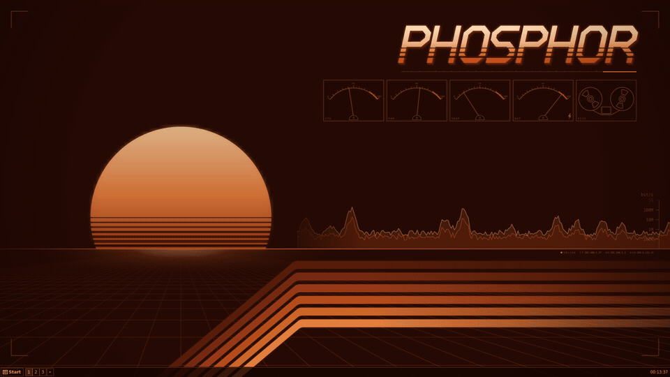](screenshots/landscape.png)

<sub>Scaled down. Click for a full-resolution still.</sub>

## Themes

Pick one with `--theme NAME`. Click a picture for a full-resolution still.

<table>
<tr><td>
<a href="screenshots/landscape.png"></a><br>
<b>phosphor</b> (default): a synthwave horizon in CRT amber
</td></tr>
<tr><td>
<a href="screenshots/themes/neon_rain.png">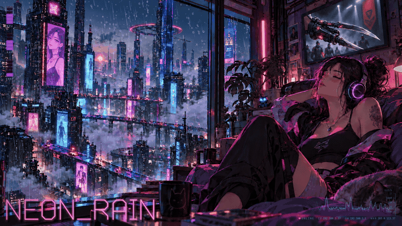</a><br>
<b>neon_rain</b>: a room over a rainy neon city
</td></tr>
<tr><td>
<a href="screenshots/themes/night_city.png">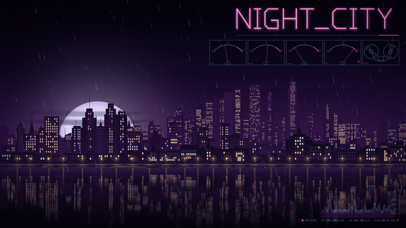</a><br>
<b>night_city</b>: a cyberpunk city in the rain
</td></tr>
<tr><td>
<a href="screenshots/themes/matrix.png">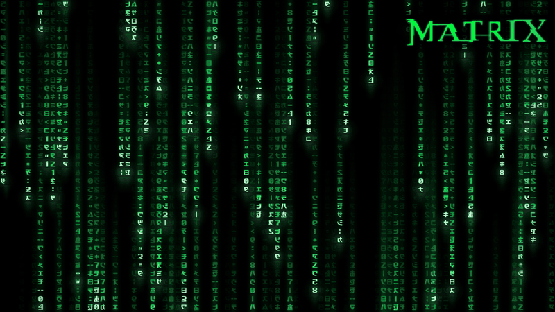</a><br>
<b>matrix</b>: the digital rain
</td></tr>
<tr><td>
<a href="screenshots/themes/aurora.png">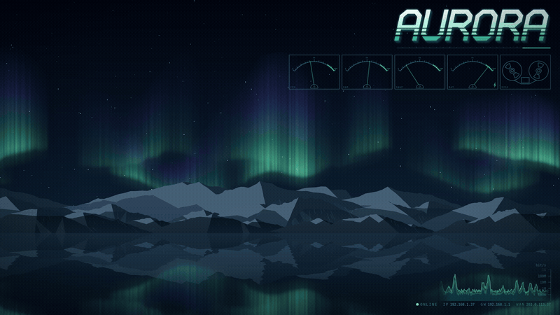</a><br>
<b>aurora</b>: northern lights over open water
</td></tr>
<tr><td>
<a href="screenshots/themes/guybrush.png">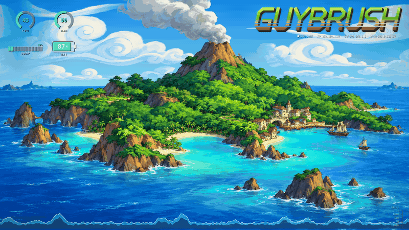</a><br>
<b>guybrush</b>: a painted pirate island
</td></tr>
<tr><td>
<a href="screenshots/themes/copperworks.png">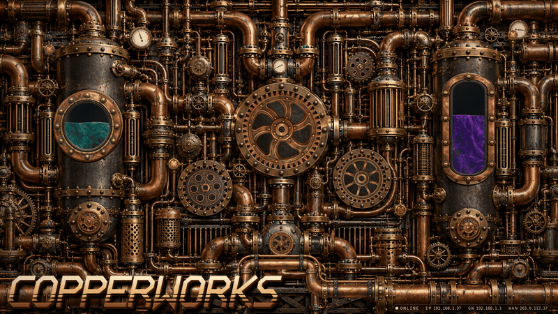</a><br>
<b>copperworks</b>: an alchemical engine that runs on the machine's readings
</td></tr>
<tr><td>
<a href="screenshots/themes/winter.png">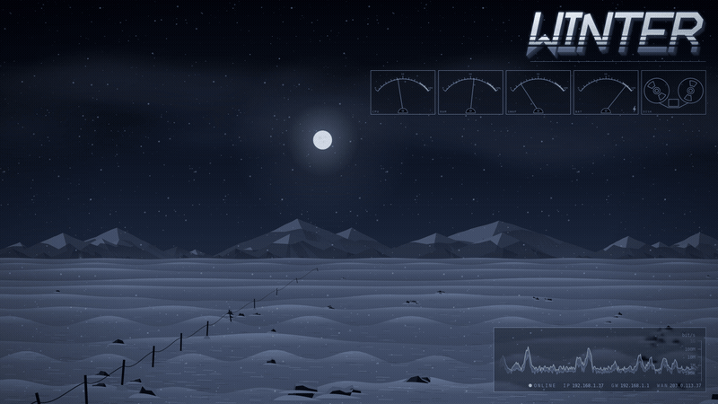</a><br>
<b>winter</b>: a snowfield that follows the clock
<br>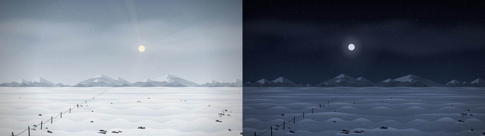
</td></tr>
<tr><td>
<a href="screenshots/themes/racing.png">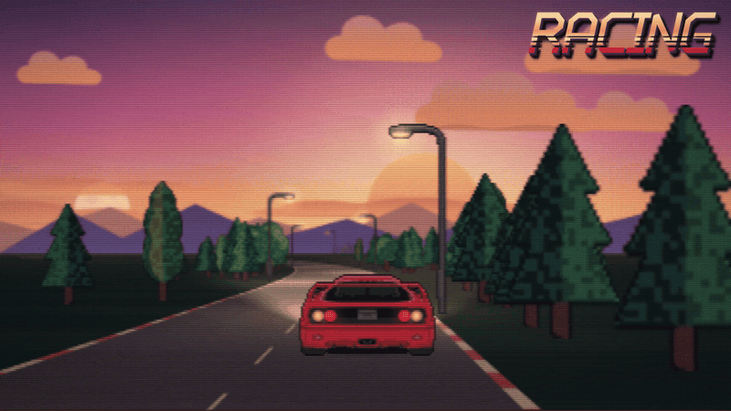</a><br>
<b>racing</b>: an old DOS racer that follows the clock
<br>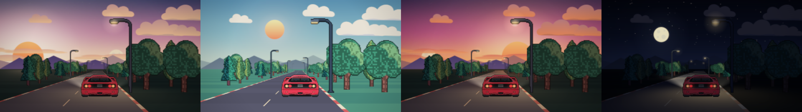
</td></tr>
<tr><td>
<a href="screenshots/themes/forest.png">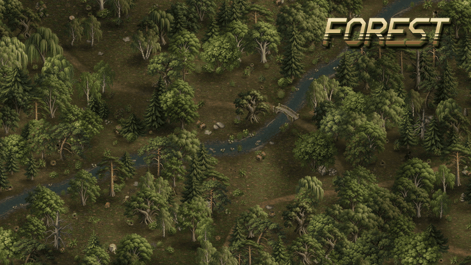</a><br>
<b>forest</b>: an isometric woodland, laid out anew each start
<br><a href="screenshots/themes/forest-1.jpg">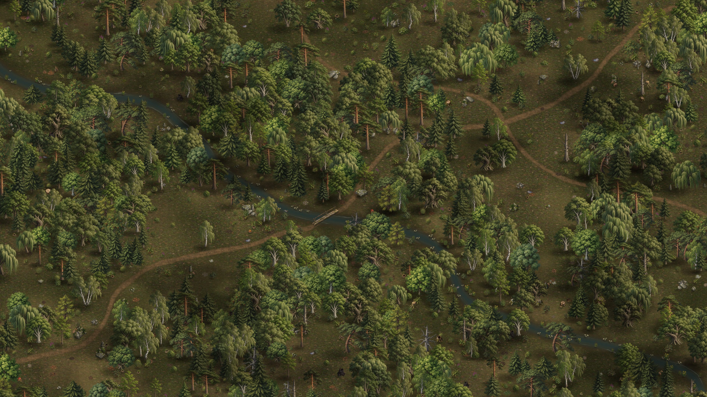</a>
<a href="screenshots/themes/forest-2.jpg">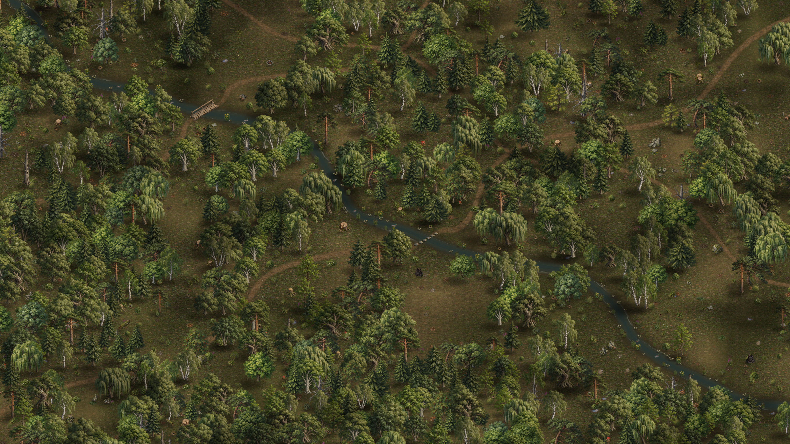</a>
<br><a href="screenshots/themes/forest-3.jpg">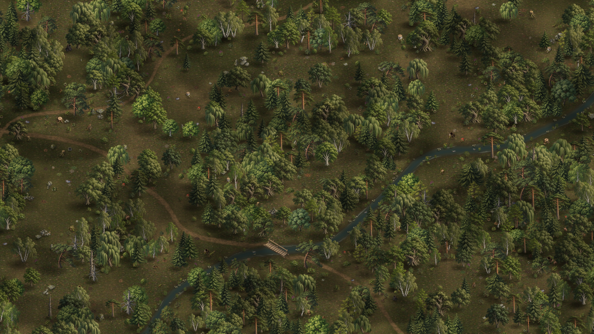</a>
<a href="screenshots/themes/forest-4.jpg">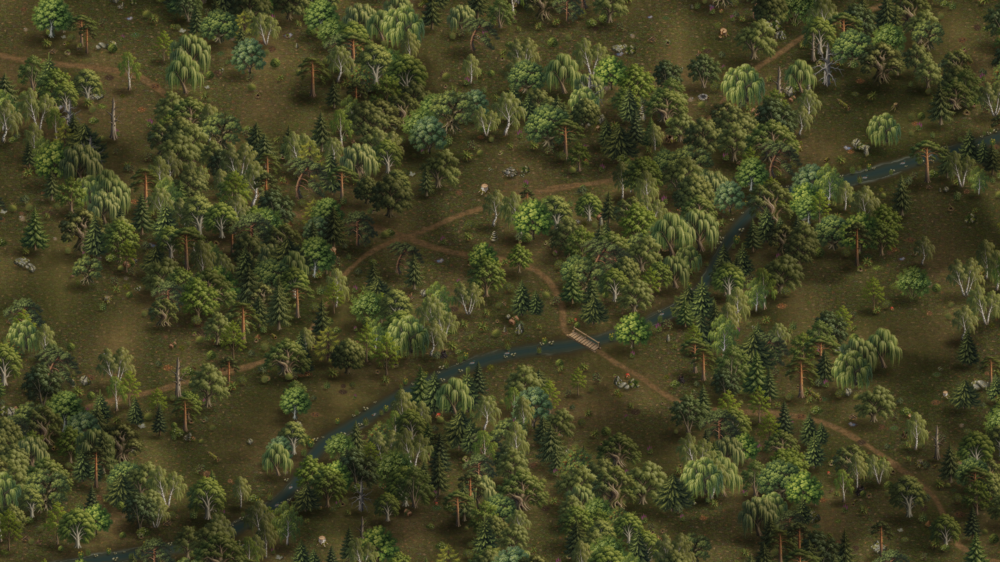</a>
<br>Four layouts at 4K: click one for the full picture.
</td></tr>
</table>

matrix, racing and forest show only the scene by default. Set `[monitors]` in `retro.toml` to show the
hostname, instruments and graph, as here.

Made a theme of your own? Share it: `retro-wall --new theme NAME` starts one, `EXTENDING.md` shows what
it can do, and a pull request with the theme and a GIF of it (made from `--snapshot --frames`) puts it here
for everyone.

It stays below every window and desktop icon, and clicks go to the desktop:

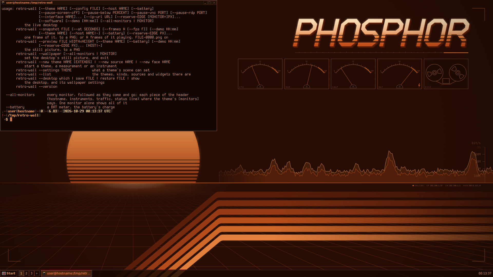

Every size is a fraction of the screen, so each theme fits any resolution, portrait included. A painted
theme is cropped around a point the theme sets:

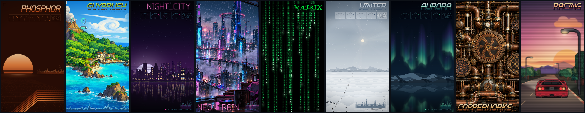

## Install

Each release has an archive for Linux (x86_64), macOS (Apple silicon) and Windows (x86_64): the
program, the themes and that system's installer. Unpack it and run the installer as yourself, not as
an administrator. Running it again updates; the uninstaller puts the desktop's own wallpaper back.

**Linux** (X11: XFCE, KDE Plasma, GNOME, Cinnamon, MATE, LXDE, or a window manager alone; glibc 2.35 or
newer: Debian 12, Ubuntu 22.04 and later):

```sh
tar xzf retro-wall-VERSION-linux-x86_64.tar.gz && cd retro-wall-VERSION-linux-x86_64
linux/install                 # libraries if missing, ~/.local/share/retro, starts at login and now
linux/uninstall               # back as it was
```

**macOS** (11 or later):

```sh
tar xzf retro-wall-VERSION-macos-arm64.tar.gz && cd retro-wall-VERSION-macos-arm64
xattr -dr com.apple.quarantine .   # a downloaded program is held back until this, or until allowed
macos/install                 # ~/Library/Application Support/retro-wall, a LaunchAgent, starts now
macos/uninstall
```

**Windows** (10 or 11): unpack `retro-wall-VERSION-windows-x86_64.zip`, then in that directory:

```powershell
powershell -ExecutionPolicy Bypass -File windows\install.ps1     # %LOCALAPPDATA%\retro-wall, at logon and now
powershell -ExecutionPolicy Bypass -File windows\uninstall.ps1
```

### From source

With Rust (`rustup`, edition 2024) and cairo's development files:

```sh
# Linux: apt install libcairo2-dev, dnf install cairo-devel, or pacman -S cairo
cargo build --release
linux/install
```

The release build is stripped; `cargo build --profile profiling` keeps symbols and line tables for a
profiler. macOS and Windows builds link cairo statically, so the binary needs nothing installed. The
release recipes, the Linux one in an older system for its glibc, are in `ci/README.md`. Then
`macos/install`, or `windows\install.ps1` with `retro-wall.exe` from
`target\x86_64-pc-windows-gnu\release` put beside `windows\`.

The typeface, DejaVu Sans Mono, is carried in the program: nothing to install.

### macOS installer

`macos/install [OPTION]...` works from a release archive or a checkout (it builds with cargo). The
OPTIONs are retro-wall's own and go in the LaunchAgent; run `macos/install` again to change them. On a
Mac whose desktop picture is set by a configuration profile, retro-wall shows its still picture itself.

### Windows installer

`windows\install.ps1 [OPTION]...` takes retro-wall's options, for example `--theme neon_rain`. It
installs into `%LOCALAPPDATA%\retro-wall` and registers the scheduled task `\retro-wall\retro-wall`,
which starts it at logon and brings it back within 5 minutes if it stops. Run it again to update or to
change the options. The log is `%LOCALAPPDATA%\retro-wall\retro-wall.log` (a run from a
console writes to the console). `retro.toml`, plugins and your own themes go in `%APPDATA%\retro`.

## Use

```sh
retro-wall                                   # the live wallpaper (the installer starts it)
retro-wall --theme neon_rain                 # another theme
retro-wall --all-monitors                    # every monitor, followed as they come and go
retro-wall --snapshot out.png                # one frame, fixed readings
retro-wall --snapshot f.png --frames 90      # three seconds of it playing: f-0000.png to f-0089.png
retro-wall --preview out.png 2560x1440       # the still picture
retro-wall --list                            # themes, element kinds, sources, widget types
retro-wall --help                            # every option
```

Options for the autostarted instance go in `~/.config/retro/retro-wall.conf`, one line per display:
`:0.0  --theme winter --battery --pause-screen-off`. The theme, the instruments' layout and plugin
sources go in `~/.config/retro/retro.toml`.

Themes: `phosphor` (the default), `neon_rain`, `night_city`, `aurora`, `winter`, `matrix`, `guybrush`,
`copperworks`, `racing`, `forest`.

## Extending

A new measurement is a program that prints a number; a new instrument a program that answers with
drawing operations; a new theme a `theme.toml` and pictures, with GLSL for motion of its own.
`retro-wall --new source|face|theme NAME` writes a working, commented start, and `examples/` has more
to copy: a `retro.toml` with the instruments moved and plugins added, sources (a clock, the GPU's
temperature, news headlines), an instrument, and a theme with a shader. See `EXTENDING.md`.

## Tests

```sh
cargo test --release          # under Xvfb where it is installed: the GL tests are skipped without it
```

In a container with everything the tests need: `ci/README.md`, "Tests".

The multi-monitor tests run the wall on several virtual monitors, plugged in and out as it runs: Xorg's
dummy driver, `xrandr` and `xwd` (Debian: `xserver-xorg-video-dummy x11-xserver-utils x11-apps`).
Without them they are skipped.

`RETRO_BLESS=1 cargo test --release --test gl` writes the reference pictures again;
`RETRO_TEST_FULL=1` runs every limit case, not a sample. The install test runs a desktop in a
container: `docker run --rm -v "$PWD:/src:ro" debian:trixie /src/tests/linux/container xfce` (after
`cargo build --release --example screen`). CI (`.github/workflows/`) runs all of it, and builds for
macOS and Windows; a `v*` tag makes a release.

How it is built: `ARCHITECTURE.md`. License: GPL-3.0-only (`LICENSE`), copyright © 2026 Øyvind Hvidsten; the font's own is `fonts/LICENSE`.
